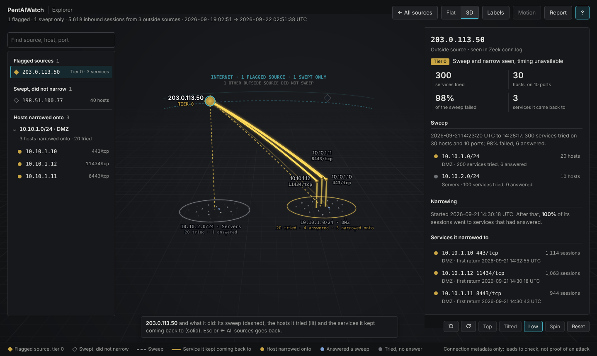

# PentAIWatch

PentAIWatch reads network logs (Zeek `conn.log`, Palo Alto traffic and threat logs) and flags
outside addresses whose behaviour towards your internal hosts looks like an agentic, AI-driven
penetration-testing tool: a sweep of many hosts or ports, a return to only the services that
answered, and short bursts of activity separated by pauses while a model decides what to do next.

**Status.** This version reads Zeek `conn.log` and Palo Alto traffic logs, alone or together,
and scores two of the three signals: the sweep and the narrowing. Every flagged source is reported
as *Tier 0. Sweep and narrow seen, timing unavailable*. It writes a report and an
[Explorer](#explorer), a 3D map of what each source swept and came back to. The timing signal, the
Explorer's Timeline and the threat-log confidence levels arrive in the next pull requests. How
each signal is worked out is in [METHODS.md](METHODS.md).

## Run it

    pip install -r requirements.txt
    python -m pentaiwatch analyze /path/to/logs -o pentaiwatch_out

It needs Python 3.10 or newer and DuckDB 1.2 or newer. DuckDB 1.3.0 is refused: it returns wrong
results for joins on a time range, which made the detection find nothing without any error.

`/path/to/logs` is a folder (read recursively) or a list of files, plain or `.gz`:

| Log | Accepted as |
|---|---|
| Zeek `conn.log` | TSV or JSON |
| Palo Alto traffic log | A CSV export with a header row, or syslog lines without one |

Give it either log or both. A session that Zeek and the firewall both recorded is counted once.
The output folder gets:

| File | What it is |
|---|---|
| `report.html` | The report, one self-contained page. Open it in a browser. |
| `explorer.html` | The [Explorer](#explorer): the same run as a map, one self-contained page. |
| `report.md` | The same report as Markdown. |
| `results.json` | Everything the report shows, as data. |

Only connection metadata is read, so nothing here needs SSL decryption. The tool makes no
network connections, and neither do the pages it writes.

## Explorer



`explorer.html` draws the run as a map, with the look and the controls of VulnScope MAX's Explorer.

- **Rings and dots.** Each ring is one of your subnets (a /24) and each dot a host that an
  outside source tried: grey when nothing answered, blue when it answered a sweep, and in the
  tier's colour, on a tall pillar, when a source kept coming back to it.
- **The INTERNET arc.** The outside sources that swept sit on an arc above the network. A filled
  diamond is a flagged source, a hollow one swept and did not narrow.
- **Beams.** A dashed beam is a source's sweep of one subnet. A solid beam goes down to a host
  the source kept coming back to. With many sources the sweeps fade to a haze, so the solid
  beams stand out.
- **Click a source** for its sweep, the hosts it tried and the evidence the report gives.
  **Click a host** for every source that tried it. Each finding in the report links to its
  source on the map (`explorer.html#source=203.0.113.50`).

The map opens in 3D on the Low view, slowly turning. Drag rotates, right-drag or Shift-drag pans,
middle-drag moves the picture up or down and the wheel zooms. **Flat** gives the same picture
from above with the sources in a row. **?** says what is on screen, and the search box finds a
source, a host, a subnet or a port.

A big run is cut to what a browser draws comfortably: 48 sources (flagged ones first, then the
largest sweeps), 120 subnets and 2,000 hosts, chosen so that every host a source kept coming back
to is drawn. The counts stay whole, and the page says what is not drawn. The Timeline of a
source's bursts and pauses arrives with the timing signal.

To see it without logs of your own:

    python scripts/smoke/explorer_smoke.py --samples demo --build-only

writes the tests' sample logs into `demo/input/`, analyzes them and leaves
`demo/zeek_only/explorer.html` (and three more runs) to open.

## Optional files in the input folder

| File | What it does |
|---|---|
| `network_map.csv` | Your address ranges with names (`cidr,name,type`). Every range in it counts as internal, and the names appear in the report. Without it, RFC 1918 ranges are internal. |
| `known_scanners.csv` | Sources that are never flagged (`address,name`): your own scanners, attack-surface services, a red team you hired. |
| `pentaiwatch.json` | Settings you want to change. Every threshold is a setting. |

Each can also be given on the command line: `--network-map`, `--known-scanners`, `--config`.

### Settings

`pentaiwatch.json` only needs the settings you change. These are all of them, with defaults:

```json
{
  "internal_nets": ["10.0.0.0/8", "172.16.0.0/12", "192.168.0.0/16"],
  "allowlist": [],
  "lookback_hours": 72,
  "window_hours": 2,
  "dedup_skew_seconds": 2.0,
  "probing": {
    "min_ports": 50,
    "min_hosts": 20,
    "min_failed_share": 0.7,
    "zeek_failed_states": ["S0", "REJ", "RSTOS0", "RSTR"],
    "zeek_icmp_by_reply": true
  },
  "narrowing": {
    "max_answered_share": 0.1,
    "min_sessions_per_service": 5,
    "max_start_delay_minutes": 15,
    "min_focus_share": 0.6,
    "zeek_answered_states": ["SF", "S1", "S2", "S3", "RSTO"],
    "protocols": ["tcp", "udp"]
  },
  "paloalto": {
    "fields": {
      "type": ["Type"],
      "subtype": ["Threat/Content Type"],
      "start": ["Start Time"],
      "end": ["Generate Time", "Generated Time", "Receive Time", "Time Logged"],
      "elapsed": ["Elapsed Time (sec)", "Elapsed Time", "elapsed"],
      "source": ["Source address", "Source IP", "src_ip"],
      "destination": ["Destination address", "Destination IP", "dst_ip"],
      "source_port": ["Source Port", "src_port"],
      "destination_port": ["Destination Port", "dst_port"],
      "protocol": ["IP Protocol", "Protocol"],
      "action": ["Action"],
      "bytes_sent": ["Bytes Sent"],
      "bytes_received": ["Bytes Received"],
      "packets_received": ["Packets Received", "pkts_received"],
      "application": ["Application"],
      "source_zone": ["Source Zone", "From Zone"],
      "destination_zone": ["Destination Zone", "To Zone"],
      "threat_name": ["Threat/Content Name", "Threat Name", "Threat ID", "Name"],
      "severity": ["Severity"]
    },
    "syslog_offsets": {
      "subtype": 1, "end": 3, "source": 4, "destination": 5, "application": 11,
      "source_zone": 13, "destination_zone": 14, "source_port": 21, "destination_port": 22,
      "protocol": 26, "action": 27, "bytes_sent": 29, "bytes_received": 30, "start": 32,
      "elapsed": 33, "packets_received": 42
    },
    "threat_syslog_offsets": {
      "threat_name": 29, "severity": 31
    },
    "deny_actions": ["deny", "drop", "reset", "block"],
    "skip_subtypes": ["start"],
    "failed_max_packets_received": 0,
    "answered_min_bytes_received": 1
  }
}
```

A name that is not a setting is refused, so a typo cannot silently leave a default in place.

## Palo Alto logs

Nothing about the export's layout is fixed in the code. It is all under `paloalto` in the
settings, and you only write the entries you change:

```json
{ "paloalto": { "fields": { "elapsed": ["Session Duration"], "source": "Client IP" } } }
```

- **`fields`** is for CSV exports with a header row. Each field lists the column names that may
  hold it, and the first one the file has is used. Names are compared ignoring case, spaces and
  punctuation. `source` must be the address before any NAT.
- **`syslog_offsets`** is for syslog lines without a header. Each field has a position counted
  from the Type column (the one holding `TRAFFIC`), so a syslog prefix in front does not matter.
  Use `null` for a field your lines do not have.
- **`deny_actions`**: an action that starts with one of these words means the firewall stopped
  the session.
- **`skip_subtypes`**: traffic rows of these subtypes are left out. A `start` row is written when
  a session opens, before any reply could be counted, and the session is logged again at its end.
- **`failed_max_packets_received`** and **`answered_min_bytes_received`** decide when an allowed
  session failed or was answered. See [METHODS.md](METHODS.md).

**Where the default names come from.** The columns of the Palo Alto export bundled with VulnScope
MAX's samples, plus the other spellings MAX's reader accepts. That export has no generated time,
no elapsed time and no packet count. For those three, the defaults are the names in Palo Alto's
published log format and have not been checked against a real export yet. A name your file does
not have is simply not used, and the report's input table lists the columns the times and the
packet count were read from, so a wrong name shows up there instead of in the results.

**Start times.** Timing is only ever worked out from session start times. For each traffic row
the start is the start-time field if it has a value, else the end time minus the elapsed seconds.
A row with neither keeps its end time, so the sweep and the narrowing can still be seen, is never
used for timing, and is counted in a warning. Each finding says how its start times were found.

**Stops instead of guessing.** A traffic export without a column for the source, destination,
destination port, protocol, action, bytes received, or any time stops the run with a message that
names the file, what is missing and the columns the file does have.

## Known limitations

- **Proxy rotation splits campaigns.** These tools rotate through residential, datacenter and
  free proxies or Tor when blocked. Scoring is per source address, so one campaign can be split
  across several sources, each below the thresholds or each reported on its own. Grouping
  sources by targeted service, time window and network owner (ASN) is planned; the detection
  keeps what that step needs.
- **Inbound only.** Outside sources towards internal hosts. Activity between internal hosts and
  outbound traffic from a compromised host are not looked at.
- **Not flagged does not mean cleared.** Only connection metadata is read.
- **Threat logs are read, not scored yet.** Palo Alto threat rows are counted in the report. They
  do not raise or lower a finding until the threat-log levels are built.
- **Firewall times are read as UTC.** Palo Alto logs carry no time zone. If the firewall logs
  local time, export in UTC. When Zeek logs are present too, a clock difference is detected and
  reported.

## Code taken from VulnScope MAX

The log reading and session storage come from
[VulnScope MAX](https://github.com/bayanilla/vulnscope_max) at commit `6a7ac93`, trimmed to what
this tool needs. When a parser or de-duplication fix lands in MAX, compare these files and carry
it over.

| Here | From MAX | What changed |
|---|---|---|
| `pentaiwatch/parsers/zeek.py` | `vulnflow/parsers/zeek.py` | Industrial-protocol handling removed. Each session keeps Zeek's raw `conn_state`, the packets sent back, and a note that its time is a start time. A `conn.log` without `conn_state` stops the run. |
| `pentaiwatch/parsers/paloalto.py` | `vulnflow/parsers/paloalto.py` | Column names, syslog positions and deny actions moved from the code into the settings. Each session gets a start time (start field, else end minus elapsed, else marked as having none) and the packets sent back. Session-start records are left out. A traffic export without a needed column stops the run instead of being read as empty. |
| `pentaiwatch/parsers/_util.py` | `vulnflow/parsers/_util.py` | One addition: a ping (ICMP) is stored without ports by both readers, so the two logs agree on it. |
| `pentaiwatch/store.py` | `vulnflow/store.py` | Explorer queries and Zeek event storage removed. Three session columns added: `state`, `pkts_in`, `start_method`. De-duplication is the same SQL. Two small tables added: which kinds of log recorded each source (taken before de-duplication), and the IPS alerts. |
| `pentaiwatch/load.py` | `vulnflow/normalize.py` | Nessus findings removed. Files that are not Zeek or Palo Alto logs are left out and listed. |
| `pentaiwatch/schema.py` | `vulnflow/schema.py` | Findings and industrial events removed. Sessions gain the three fields above. |
| `pentaiwatch/netmap.py`, `scanners.py` | same names | Reading of `network_map.csv` and `known_scanners.csv` only. |
| `pentaiwatch/resources.py`, `errors.py` | same names | Settings are named `PENTAIWATCH_...` instead of `VULNSCOPE_...`. |

The Explorer page is put together from MAX's too:

| Here | From MAX | What changed |
|---|---|---|
| `pentaiwatch/static/explorer3d.js` | `vulnflow/static/explorer3d.js` | Nothing. The 3D renderer, byte for byte. |
| `pentaiwatch/static/vendor/three.min.js`, `three.LICENSE` | `vulnflow/static/vendor/` | Nothing. Three.js r149 (MIT). |
| `pentaiwatch/static/vf_data.js` | `vulnflow/static/vf_data.js` | Three messages reworded. It unpacks the data inside the page. |
| `pentaiwatch/static/explorer.css` | `vulnflow/static/explorer.css` | MAX's Graphite theme only, as one flat set of rules. Styles of views this tool does not have are gone. |
| `pentaiwatch/static/explorer.js`, `explorer.html` | `vulnflow/static/explorer.js`, `explorer.html` | Written for this tool, because what is drawn is different: sources, sweeps and the services narrowed onto. The subnet packing, camera, mouse and keyboard controls, label placement and the "?" note follow MAX's. |
| `pentaiwatch/explore.py` | `vulnflow/explore.py` | The scene is this tool's own. How the data is packed into the page (gzip in base64, scripts inline) is MAX's. |
| `scripts/smoke/explorer_smoke.py` | same name | The same approach, with this page's checks. |

## Development

    pip install -r requirements-dev.txt
    python -m unittest discover -s tests -t .
    ruff check . && mypy
    python scripts/check_repo.py

The tests generate their own logs (`tests/kit.py`, `tests/sample.py`): an agentic source, a plain
scanner and an ordinary client, written as Zeek `conn.log`, as a Palo Alto CSV export and as Palo
Alto syslog lines. No log files are committed.

The Explorer page is checked in a real browser. `scripts/smoke/explorer_smoke.py` writes the
sample logs four ways, analyzes them, opens each `explorer.html` in headless Chromium and walks
the 3D view, a source, a host, the Flat view and the report's link to the map. It fails on any
page error, on a body or a beam that is not drawn, and on a run with nothing to draw that does
not say so:

    pip install playwright==1.63.0 && python -m playwright install chromium
    python scripts/smoke/explorer_smoke.py --samples smoke-work

CI runs the same checks on every pull request.

### Checked on a real capture

CI also runs the tool on a real capture: Brim's public WRCCDC 2018 Zeek logs, a million sessions
from 21 minutes of a cyber defence competition, recorded years before agentic tools existed. The
files are downloaded on the CI machine (pinned to an exact commit, SHA-256 checked) and are never
committed.

    python scripts/realdata/fetch.py brim-data
    python scripts/realdata/check.py brim-data realdata-work

It checks that the counts match a separate plain reading of the log, that the same sources are
flagged from every form of the log, and that the agentic source the unit tests use, added to the
capture, is flagged from Zeek alone, from a Palo Alto form of the same sessions, and from both
with every session counted once. The Palo Alto form is written from the Zeek log by
`scripts/realdata/to_paloalto.py`; it is not a real firewall log.

What the capture shows about the signals:

- 15 outside sources sweep hard enough to fire the probing signal. 14 of them never narrow, so
  they are not flagged. Most rescan the same range again and again: after their first return, at
  most 7% of their sessions go to services that answered (two come closer, at 29% and 50%).
  Without the `min_focus_share` condition, 13 of those 14 would be flagged.
- One source is flagged, from every form of the log: an nmap run (a ping sweep of 8,192
  addresses, a port scan, then service detection on what answered). Sweep-then-narrow is what
  service detection looks like, which is why tier 0 alone is weak evidence and the timing signal
  matters. Its sweep is mostly pings. Zeek gives every ICMP record the state `OTH`, so a ping is
  judged by its reply in both logs (see METHODS.md); judged by state alone, the Zeek log missed
  this sweep and the firewall form did not.
- A refused connection counts as failed in Zeek (`REJ`) and as answered on the firewall (a reset
  came back). In this capture, where nothing drops the sweeps, that leaves only 4 of the 15
  sweeping sources recognised in the Palo Alto form. See METHODS.md.

## License

MIT. See [LICENSE](LICENSE).
