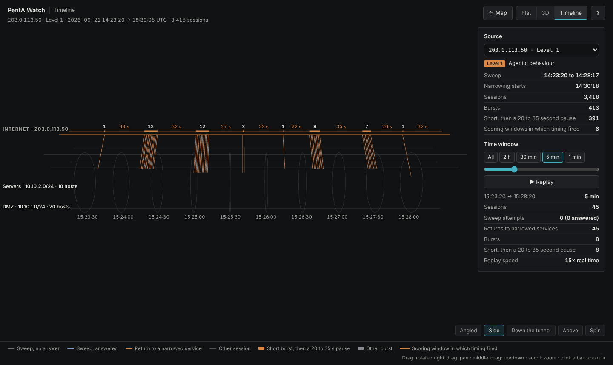

# PentAIWatch

PentAIWatch reads network logs (Zeek `conn.log`, Palo Alto traffic and threat logs) and flags
outside addresses whose behaviour towards your internal hosts looks like an agentic, AI-driven
penetration-testing tool: a sweep of many hosts or ports, a return to only the services that
answered, and short bursts of activity separated by pauses while a model decides what to do next.

**Status.** This version reads Zeek `conn.log` and Palo Alto traffic logs, alone or together,
and scores all three signals: the sweep, the narrowing and the timing, which fires on short bursts
separated by think-time pauses or on a fixed-interval cadence. A source where all three fire is
reported as *Level 1. Agentic behaviour*. When the sweep and the narrowing fire but the
sessions have no start time to check the pace by, it is reported one step lower, as *Tier 0. Sweep
and narrow seen, timing unavailable*. It writes a report and an [Explorer](#explorer): a 3D map of
what each source swept and came back to, and a [Timeline](#timeline) that replays a source's
sessions with its bursts and pauses. The threat-log confidence levels (2 and 3) arrive in the
next pull request. How each signal is worked out is in [METHODS.md](METHODS.md).

## Run it

    pip install -r requirements.txt
    python -m pentaiwatch analyze /path/to/logs -o pentaiwatch_out

It needs Python 3.10 or newer and DuckDB 1.2 or newer. DuckDB 1.3.0 is refused: it returns wrong
results for joins on a time range, which made the detection find nothing without any error.

`/path/to/logs` is a folder (read recursively) or a list of files, plain or `.gz`:

| Log | Accepted as |
|---|---|
| Zeek `conn.log` | TSV or JSON |
| Palo Alto traffic log | A CSV export with a header row, or syslog lines without one |

Give it either log or both. A session that Zeek and the firewall both recorded is counted once.
The output folder gets:

| File | What it is |
|---|---|
| `report.html` | The report, one self-contained page. Open it in a browser. |
| `explorer.html` | The [Explorer](#explorer): the same run as a map, one self-contained page. |
| `report.md` | The same report as Markdown. |
| `results.json` | Everything the report shows, as data. |

Give the run a name and a few lines about it with `--name "DMZ sweep review" --description
"Case 42, asked by the SOC"`: they are shown at the top of the report and in the Explorer, and kept
in `results.json` as `report`.

Only connection metadata is read, so nothing here needs SSL decryption. The tool makes no
network connections, and neither do the pages it writes.

## Upload page

    python -m pentaiwatch serve

or `python start_upload_page.py`, which also opens it in the browser. It serves
`http://127.0.0.1:8770/` (the next free port if that one is taken) on this computer only, and
works like VulnScope MAX's upload page:

- **Folder on this computer.** Type a path or click **Browse…** (on a Mac, the system's Choose
  Folder dialog; elsewhere, a list of folders on the page). The logs are read where they are,
  nothing is copied. This is the way for large folders.
- **Open a saved report.** Point the same field at a finished report's output folder (the one
  with `results.json`) and the button says **Open report**: the report and the Explorer are
  written again with this version's code, from `results.json` and the data inside the old
  `explorer.html`, without reading the logs. The folder itself is not changed. Its files are
  checked before use: a file from another tool, from a newer PentAIWatch, over 256 MB, or an
  `explorer.html` from a different run than its `results.json` is refused with the reason.
- **Or upload files.** Choose a folder of logs, or single files, up to 20 GB in all
  (`--max-upload-gb`). An upload is streamed to disk and refused up front when the disk lacks room
  for it plus 2 GB to work in. File names and subfolders are kept, so a `pentaiwatch.json`,
  `network_map.csv` or `known_scanners.csv` among them is used as it would be on the command line.
- **Internal networks (optional).** Ranges typed here take the place of the settings file's
  `internal_nets` for this run, and the report says so.
- **Report details (optional).** A report name and a description, as `--name` and
  `--description` give on the command line. The run's folder is named after the report plus the
  date and time, for example `DMZ-sweep-review_2026-11-19_10-19-14`.

The analysis runs in the background. Its page shows a timer while it runs (the tab can be closed)
and then the result: the flagged sources, each with links to its place on the map and its
Timeline, and the report, the Explorer, `report.md` and `results.json`. **Recent reports** on the
upload page lists the last ten runs. Each run is a folder in `pentaiwatch_runs/` (`--data-dir`),
named after the report, or a random name, plus the date and time:
`in/` holds the uploads (or `SOURCE.txt`, the list of files read in place), `out/` the usual
output, and `STATUS.json` how the run went. One analysis runs at a time (`PENTAIWATCH_MAX_JOBS`).
The page's own [security notes](#security-notes) are at the end of that section.

## Explorer


`explorer.html` draws the run as a map, with the look and the controls of VulnScope MAX's Explorer.

- **Rings and dots.** Each ring is one of your subnets (a /24) and each dot a host that an
  outside source tried: grey when nothing answered, blue when it answered a sweep, and in the
  tier's colour, on a tall pillar, when a source kept coming back to it.
- **The INTERNET arc.** The outside sources that swept sit on an arc above the network. A filled
  diamond is a flagged source. A hollow one swept and is not flagged: it did not narrow, or it
  narrowed at a pace that is not an agent's (click it to see which, and why).
- **Beams.** A dashed beam is a source's sweep of one subnet. A solid beam goes down to a host
  the source kept coming back to. With many sources the sweeps fade to a haze, so the solid
  beams stand out.
- **Click a source** for its sweep, the hosts it tried and the evidence the report gives.
  **Click a host** for every source that tried it. Each finding in the report links to its
  source on the map (`explorer.html#source=203.0.113.50`).

The map opens in 3D on the Low view, slowly turning. Drag rotates, right-drag or Shift-drag pans,
middle-drag moves the picture up or down and the wheel zooms. **Flat** gives the same picture
from above with the sources in a row. **Timeline** replays one source (see below). **?** says
what is on screen, and the search box finds a source, a host, a subnet or a port.

A big run is cut to what a browser draws comfortably: 48 sources (flagged ones first, then those
that narrowed, then the largest sweeps), 120 subnets and 2,000 hosts, chosen so that every host a
flagged source kept coming back to is drawn. The counts stay whole, and the page says what is not
drawn.

### Timeline



The map shows where a source went. The Timeline shows when. It replays one source's sessions in
the order they started, so the rhythm the timing signal counted can be seen: a few sessions, a
pause, a few sessions. It follows the Timeline of VulnScope MAX. Open it from the view switcher,
from the button in a source's panel, or from a finding in the report
(`explorer.html#timeline=203.0.113.50`). Every drawn source that swept and then narrowed has one,
flagged or not, so an agent's pace can be put next to a scanner's.

- **The tunnel.** Time runs left to right. The source rides the INTERNET band on top. Each lane
  on the wall is a subnet it went to, with its hosts in address order.
- **Lines.** Every session is a line from the source down to the host, at the moment the session
  started: grey for a sweep attempt that nothing answered, blue for one that was answered, and the
  tier's colour for a return to a service the source narrowed onto.
- **Bars.** The bars above the band are the source's bursts, exactly as the timing signal cut
  them. A bar in the tier's colour is a short burst followed by a pause inside the band (20 to 35
  seconds unless your settings say otherwise), and a thin line crosses that pause. A grey bar is
  any other burst: the sweep, a burst that is too long, or one followed by a longer or shorter
  pause. The source's track is lit over the scoring windows in which the timing signal fired.
- **Window.** *All* shows the whole campaign. The shorter windows, down to one minute, show single
  bursts, with the number of sessions on each bar and the seconds on each pause. Drag the slider
  to move the window, click a bar to zoom in on it, or press **Replay** to watch the sessions
  arrive in order.

The mouse works as on the map, and **Angled**, **Side**, **Down the tunnel** and **Above** set
the camera. The first 12 sources that narrowed get a Timeline. A source with more than 20,000
sessions is drawn thinned (every second session, or every third, and so on); its bursts are still
counted from all of them, and the page says so. Sessions that have only an end time are drawn at
that time and belong to no burst.

To see it without logs of your own:

    python scripts/smoke/explorer_smoke.py --samples demo --build-only

writes the tests' sample logs into `demo/input/`, analyzes them and leaves
`demo/zeek_only/explorer.html` (and four more runs) to open.

## Optional files in the input folder

| File | What it does |
|---|---|
| `network_map.csv` | Your address ranges with names (`cidr,name,type`). Every range in it counts as internal, and the names appear in the report. Without it, RFC 1918 ranges are internal. |
| `known_scanners.csv` | Sources that are never flagged (`address,name`): your own scanners, attack-surface services, a red team you hired. |
| `known_bad.csv` | Attacker addresses to flag on sight (`address,name,confidence,reference`; an address, a CIDR range or `first-last`). Added to the bundled list described under [Published attacker addresses](#published-attacker-addresses). |
| `pentaiwatch.json` | Settings you want to change. Every threshold is a setting. |

Each can also be given on the command line: `--network-map`, `--known-scanners`, `--known-bad`, `--config`.

### Published attacker addresses

PentAIWatch comes with a list of the addresses vendors published for ARTEX and CyberStrikeAI
activity (`pentaiwatch/data/known_bad.csv`): CrowdStrike, Microsoft, Check Point, Censys and Team
Cymru as collected by the MIT-licensed
[artex-hunting-pack](https://github.com/SecureDataSolutions/artex-hunting-pack), plus the four
addresses of Unit 42's note of 30 October 2026. Each row keeps who published it, how sure they
were and where. `scripts/known_bad/build.py` rebuilds it from a newer copy of the pack; PentAIWatch
never downloads it.

A source on that list, or on your own `known_bad.csv`, that reached an internal host is flagged
whatever its traffic looked like. When its traffic also fired the three signals, its finding says
it is a published address; otherwise it is listed under *Published attacker addresses* in the
report, with its sessions, the services it reached and the list's entry. The allowlist and
`known_scanners.csv` still win, with a warning. Some of these addresses are attacker servers and
VPN exits rather than scanners, and the low-confidence Censys rows are hosts seen running the tools,
not seen attacking: read the confidence before acting on a match. Set `known_bad_bundled` to
`false` to use only your own list.

### Fixed-interval repetition

A scripted login brute force retries at a fixed rate: CyberStrikeAI's FortiGate runs tried a
password every 1.5 seconds with no jitter. A source that sends `steady.min_sessions` (30) or more
sessions in a row to one service, each within `steady.max_gap_seconds` (10) of the last, with gaps
that vary by no more than `steady.max_jitter` (10%) of their mean, keeps a fixed interval. For a
source that swept and narrowed, that is the second timing pattern and makes it Level 1. On its own
it is a **lead**, because a health check keeps just as even a gap; it is flagged when the same
source also swept, or shows high-rate repeated connections on another service (see "Leads" in
[METHODS.md](METHODS.md)). Only logged start times are used (Zeek's ts or the firewall's start
field), never a start worked out from whole elapsed seconds. Palo Alto start times are whole
seconds, so a 1.5-second rate shows up as gaps of 1 and 2. A run whose gaps there are all one of two
neighbouring whole seconds (a second or more apart) counts as steady too; gaps of 0, 1, 2 and 3 do
not.

### High-rate repeated connections

A password spray against your VPN portal, webmail or remote access shows up as a flood of
connections from one address to one service. Microsoft saw up to 2,900 failed logins a minute
from one Storm-0940 address. A source that sends `spray.min_per_minute` (60, one a second) or more
sessions a minute to one TCP service, in `spray.min_minutes` (5) or more minutes, with
`spray.min_answered_share` (50%) or more of them completed, is reported. On its own it is a
**lead**, because a busy integration looks the same; it is flagged when the same source also swept,
or shows fixed-interval repetition on another service. Unlike fixed-interval repetition, the gaps
need not be even. Completed connections are what separate it
from a scan, whose connections mostly fail. The connection log shows how hard it hit, not whether a
login worked, so check that service's own log for the failures. Minutes are counted on whatever
time the session has, so it works from Zeek or from any Palo Alto export. A service that more than
`spray.max_service_sources` (20) outside addresses used is public and left out, because a busy
client of it, or many people behind one NAT address, is expected there.

### Several attack paths at once

ARTEX ran several attack paths side by side from one address. Once a flagged source has narrowed,
PentAIWatch cuts its answered sessions into bursts (the same burst gap the timing check uses) and
looks for bursts that work `parallel.min_services` (2) or more services and go back to one they
left, so they take turns between them. A tool that finishes one service before starting the next
does not count. With `parallel.min_bursts` (5) or more such bursts, the finding says "Higher
confidence" and lists the services. This never flags a source on its own, and it needs session
start times, so a Tier 0 finding never has it. Palo Alto times are whole seconds, so sessions in the
same second keep the order they have in the export.

### Rotating sources

Operators rotate through proxies: CrowdStrike lists nine for one ARTEX operator. Each address on
its own can stay under the thresholds, so PentAIWatch also ties them together. A sweep that fires
the probing signal and finds a few services answering is the anchor. Other addresses join it when
they had no session at all in the `rotation.quiet_before_hours` (2) before the sweep began (in any
of the data, older than the lookback too), their first session falls between the sweep's start and
`narrowing.max_start_delay_minutes` (15) after its end, they have
`narrowing.min_sessions_per_service` (5) or more completed sessions to a service the sweep found,
and `narrowing.min_focus_share` (60%) or more of their sessions go to those services. An address
that swept itself never joins, because it is scored on its own. With `rotation.min_joiners` (2) or
more joiners, the sweep and its joiners are listed together under "Rotating sources". Clients and
monitoring that start near someone's sweep fit that rule too, so a rotation is a **lead** unless the
sweeping address is a finding or shows fixed-interval repetition or high-rate repeated connections
itself; then it is flagged as one campaign. Every address is "first seen" when the data begins, so
a sweep that begins less than `quiet_before_hours` after the first session in the data cannot tell
new addresses from old ones: it anchors a rotation only when the sweeping address is a finding of
its own (the rotation then says its novelty is unknown), and the report counts the other such
sweeps. A service that
more than `rotation.max_service_sources` (20) outside addresses used in the lookback is public, such
as a web site, so new visitors to it never tie addresses together. A campaign whose sweep is itself
split across proxies is not tied together yet.

### Your hosts reaching out to attacker infrastructure

Inbound traffic shows an attack; a host of yours reaching out to the attacker's own servers can
mean it worked. Any session from an internal host to an address on the bundled list or your
`known_bad.csv` is flagged, with the host, the address, what the list says about it, the ports, how
many sessions it answered and when. These come first in the report.

Censys found Cobalt Strike (port 50050) and Adaptix C2 (port 4321) on ARTEX hosts. A session from
an internal host to any other outside address on one of those ports is named as a hint, under
`outbound.c2_ports`, and flags nothing: anything can listen on a port. The ARTEX console's own
ports (8787, 18080, 8081, 18899) are left out because ordinary services use them too. Set
`"outbound": {"check": false}` to skip all of this. A destination on the allowlist or in
`known_scanners.csv` is left out, as it is for sources.

### Named targets

The ARTEX and CyberStrikeAI reporting says what the agents went for: FortiGate and other firewall
consoles and VPNs, AI model gateways such as Ollama and LiteLLM, databases, and remote access. The
`targets` setting names those kinds of service by TCP or UDP port. When a flagged source narrowed
onto one, the report says so on the finding, in its services table, and beside fixed-interval runs
and published addresses, so you know which services to check first. Naming a target never changes
whether a source is flagged. Port 443 is left out on purpose: too much else answers on it.

Your own names are added to the defaults. Giving a default name replaces its ports, and an empty
list drops it, for example `"targets": {"Remote access": [], "Backup console": [9392]}`. Each port
can have one name only.

A file with one of these names anywhere under the input folder is used without being asked for,
and each of them changes what gets flagged. So the report says which ones it read (the first line
under *Settings used*, with "found among the input files" where it was not named on the command
line), and it counts the outside sources and sessions that the allowlist and
`known_scanners.csv` left out of the scoring. When more than one `pentaiwatch.json` is found, the
first is used, a warning names the others, and `--config` settles it.

### Settings

`pentaiwatch.json` only needs the settings you change. These are all of them, with defaults:

```json
{
  "internal_nets": ["10.0.0.0/8", "172.16.0.0/12", "192.168.0.0/16"],
  "allowlist": [],
  "known_bad_bundled": true,
  "lookback_hours": 72,
  "window_hours": 2,
  "dedup_skew_seconds": 2.0,
  "probing": {
    "min_ports": 50,
    "min_hosts": 20,
    "min_failed_share": 0.7,
    "zeek_failed_states": ["S0", "REJ", "RSTOS0", "RSTR"],
    "zeek_icmp_by_reply": true
  },
  "narrowing": {
    "max_answered_share": 0.1,
    "min_sessions_per_service": 5,
    "max_start_delay_minutes": 15,
    "min_focus_share": 0.6,
    "zeek_answered_states": ["SF", "S1", "S2", "S3", "RSTO"],
    "protocols": ["tcp", "udp"]
  },
  "timing": {
    "burst_gap_seconds": 15,
    "max_burst_sessions": 15,
    "pause_min_seconds": 20,
    "pause_max_seconds": 35,
    "min_cycles": 5,
    "min_pause_share": 0.6,
    "min_timed_share": 0.9
  },
  "steady": {
    "min_sessions": 30,
    "max_gap_seconds": 10,
    "max_jitter": 0.1
  },
  "spray": {
    "min_per_minute": 60,
    "min_minutes": 5,
    "min_answered_share": 0.5,
    "max_service_sources": 20
  },
  "parallel": {
    "min_services": 2,
    "min_bursts": 5
  },
  "rotation": {
    "min_joiners": 2,
    "max_service_sources": 20,
    "quiet_before_hours": 2
  },
  "outbound": {
    "check": true,
    "c2_ports": {
      "Cobalt Strike teamserver": [50050],
      "Adaptix C2": [4321]
    }
  },
  "targets": {
    "Edge device admin or VPN": [541, 4443, 8443, 9443, 10443],
    "AI model gateway": [4000, 11434],
    "Database": [1433, 1521, 3306, 5432, 6379, 9200, 27017],
    "Remote access": [22, 3389, 5985, 5986]
  },
  "paloalto": {
    "fields": {
      "type": ["Type"],
      "subtype": ["Threat/Content Type"],
      "start": ["Start Time"],
      "end": ["Generate Time", "Generated Time", "Receive Time", "Time Logged"],
      "elapsed": ["Elapsed Time (sec)", "Elapsed Time", "elapsed"],
      "source": ["Source address", "Source IP", "src_ip"],
      "destination": ["Destination address", "Destination IP", "dst_ip"],
      "source_port": ["Source Port", "src_port"],
      "destination_port": ["Destination Port", "dst_port"],
      "protocol": ["IP Protocol", "Protocol"],
      "action": ["Action"],
      "bytes_sent": ["Bytes Sent"],
      "bytes_received": ["Bytes Received"],
      "packets_received": ["Packets Received", "pkts_received"],
      "application": ["Application"],
      "source_zone": ["Source Zone", "From Zone"],
      "destination_zone": ["Destination Zone", "To Zone"],
      "threat_name": ["Threat/Content Name", "Threat Name", "Threat ID", "Name"],
      "severity": ["Severity"]
    },
    "syslog_offsets": {
      "subtype": 1, "end": 3, "source": 4, "destination": 5, "application": 11,
      "source_zone": 13, "destination_zone": 14, "source_port": 21, "destination_port": 22,
      "protocol": 26, "action": 27, "bytes_sent": 29, "bytes_received": 30, "start": 32,
      "elapsed": 33, "packets_received": 42
    },
    "threat_syslog_offsets": {
      "threat_name": 29, "severity": 31
    },
    "deny_actions": ["deny", "drop", "reset", "block"],
    "skip_subtypes": ["start"],
    "failed_max_packets_received": 0,
    "answered_min_bytes_received": 1
  }
}
```

A name that is not a setting is refused, so a typo cannot silently leave a default in place.

## Palo Alto logs

Nothing about the export's layout is fixed in the code. It is all under `paloalto` in the
settings, and you only write the entries you change:

```json
{ "paloalto": { "fields": { "elapsed": ["Session Duration"], "source": "Client IP" } } }
```

- **`fields`** is for CSV exports with a header row. Each field lists the column names that may
  hold it, and the first one the file has is used. Names are compared ignoring case, spaces and
  punctuation. `source` must be the address before any NAT.
- **`syslog_offsets`** is for syslog lines without a header. Each field has a position counted
  from the Type column (the one holding `TRAFFIC`), so a syslog prefix in front does not matter.
  Use `null` for a field your lines do not have.
- **`deny_actions`**: an action that starts with one of these words means the firewall stopped
  the session.
- **`skip_subtypes`**: traffic rows of these subtypes are left out. A `start` row is written when
  a session opens, before any reply could be counted, and the session is logged again at its end.
- **`failed_max_packets_received`** and **`answered_min_bytes_received`** decide when an allowed
  session failed or was answered. See [METHODS.md](METHODS.md).

**Where the default names come from.** The columns of the Palo Alto export bundled with VulnScope
MAX's samples, plus the other spellings MAX's reader accepts. That export has no generated time,
no elapsed time and no packet count. For those three, the defaults are the names in Palo Alto's
published log format and have not been checked against a real export yet. A name your file does
not have is simply not used, and the report's input table lists the columns the times and the
packet count were read from, so a wrong name shows up there instead of in the results.

**Start times.** Timing is only ever worked out from session start times. For each traffic row
the start is the start-time field if it has a value, else the end time minus the elapsed seconds.
A row with neither keeps its end time, so the sweep and the narrowing can still be seen, is never
used for timing, and is counted in a warning. Each finding says how its start times were found. A
source whose sessions have no start time cannot reach level 1: it is reported as tier 0. When Zeek
recorded the same session, Zeek's start time is used, whatever the export has.

**Stops instead of guessing.** A traffic export without a column for the source, destination,
destination port, protocol, action, bytes received, or any time stops the run with a message that
names the file, what is missing and the columns the file does have.

## Security notes

PentAIWatch reads logs that an outsider's traffic helped to write, and it is meant to run on an
analyst's machine or in a closed network. What it does about that:

- **Nothing leaves the machine.** The tool makes no network connections. DuckDB is told not to
  download or load extensions, which its clients otherwise do the first time a query needs one.
  The pages load nothing from anywhere.
- **Logs are only ever read as text.** Nothing in a log is run, addresses must parse as
  addresses, and values reach the database as values, never as part of a query.
- **The pages cannot run anything they did not come with.** Everything shown in `report.html`
  and `explorer.html` is escaped. Behind that, both carry a Content-Security-Policy: the report
  runs no script at all, the Explorer runs only the scripts written into it (each named by its
  SHA-256), and neither can load or send anything. The browser check tries all of that from
  inside both pages and fails if any of it gets through.
- **Files in the input folder are trusted.** A `pentaiwatch.json`, `network_map.csv` or
  `known_scanners.csv` left in a log folder decides what is internal and what is never flagged, and a
  `known_bad.csv` what is flagged on sight.
  The report names each one it read and counts what the never-flag lists left out (see
  [Optional files in the input folder](#optional-files-in-the-input-folder)). Read that line
  when the logs come from a folder other people can write to.
- **A hostile log can cost time and disk, nothing else.** A `.gz` that unpacks to far more than
  its size, or a log with very long lines, makes a run slow and takes space in the work folder
  until the run ends. DuckDB's memory and its temporary files are capped for every run. The work
  folder is private to the run and removed afterwards.

The output folder is created readable by you alone when PentAIWatch makes it. The reports hold
your internal addresses, so treat them like the logs they came from.

The [upload page](#upload-page) can read any folder your account can, so it guards itself as
VulnScope MAX's does:

- **This computer only.** It listens on 127.0.0.1 and answers only requests addressed to
  `127.0.0.1`, `localhost` or `[::1]` with its port, so a web page that points its own domain at
  your computer (DNS rebinding) is refused. `--host` with another address needs `--allow-remote`,
  and then every request must carry the access token printed at start-up. That traffic is plain
  HTTP: use it on a trusted network or through an SSH tunnel.
- **Other sites cannot drive it.** Every form and call needs a token that only the page itself
  has, and a post from another site is refused.
- **A run's files cannot act as the page.** The report and the Explorer are served in a browser
  sandbox: they run in a separate, empty origin and cannot read the upload page, its folder list
  or other runs, or post to it. Only files in a run's `out/` folder are served.
- **Runs are private.** The runs folder and every file in it are readable by you alone.

## Known limitations

- **Proxy rotation splits campaigns.** These tools rotate through residential, datacenter and
  free proxies or Tor when blocked. Scoring is per source address, so one campaign can be split
  across several sources, each below the thresholds or each reported on its own. New addresses
  that come straight back to what one sweep found are tied to it (see Rotating sources), but a
  campaign whose sweep is itself split across addresses is not tied together yet.
- **Timing sees connection starts, nothing inside a connection.** A tool that sends many requests
  over one connection it keeps open, or runs several jobs at once from one address, shows fewer
  pauses and can go unflagged.
- **Inbound behaviour, outbound by address.** The behaviour signals score outside sources
  towards internal hosts. Outbound, only sessions to published attacker addresses (flagged) and
  to command-and-control ports (hints) are looked at; an agent's other traffic out, such as calls
  to an LLM API, and activity between internal hosts are not.
- **Not flagged does not mean cleared.** Only connection metadata is read.
- **Threat logs are read, not scored yet.** Palo Alto threat rows are counted in the report. They
  do not raise or lower a finding until the threat-log levels are built.
- **Firewall times are read as UTC.** Palo Alto logs carry no time zone. If the firewall logs
  local time, export in UTC. When Zeek logs are present too, a clock difference is detected and
  reported.

## Code taken from VulnScope MAX

The log reading and session storage come from
[VulnScope MAX](https://github.com/bayanilla/vulnscope_max) at commit `6a7ac93`, trimmed to what
this tool needs. When a parser or de-duplication fix lands in MAX, compare these files and carry
it over.

| Here | From MAX | What changed |
|---|---|---|
| `pentaiwatch/parsers/zeek.py` | `vulnflow/parsers/zeek.py` | Industrial-protocol handling removed. Each session keeps Zeek's raw `conn_state`, the packets sent back, and a note that its time is a start time. A `conn.log` without `conn_state` stops the run. |
| `pentaiwatch/parsers/paloalto.py` | `vulnflow/parsers/paloalto.py` | Column names, syslog positions and deny actions moved from the code into the settings. Each session gets a start time (start field, else end minus elapsed, else marked as having none) and the packets sent back. Session-start records are left out. A traffic export without a needed column stops the run instead of being read as empty. |
| `pentaiwatch/parsers/_util.py` | `vulnflow/parsers/_util.py` | One addition: a ping (ICMP) is stored without ports by both readers, so the two logs agree on it. |
| `pentaiwatch/store.py` | `vulnflow/store.py` | Explorer queries and Zeek event storage removed. Three session columns added: `state`, `pkts_in`, `start_method`. De-duplication is the same SQL. Two small tables added: which kinds of log recorded each source (taken before de-duplication), and the IPS alerts. |
| `pentaiwatch/load.py` | `vulnflow/normalize.py` | Nessus findings removed. Files that are not Zeek or Palo Alto logs are left out and listed. |
| `pentaiwatch/schema.py` | `vulnflow/schema.py` | Findings and industrial events removed. Sessions gain the three fields above. |
| `pentaiwatch/netmap.py`, `scanners.py` | same names | Reading of `network_map.csv` and `known_scanners.csv` only. |
| `pentaiwatch/resources.py`, `errors.py` | same names | Settings are named `PENTAIWATCH_...` instead of `VULNSCOPE_...`. |

The Explorer page is put together from MAX's too:

| Here | From MAX | What changed |
|---|---|---|
| `pentaiwatch/static/explorer3d.js` | `vulnflow/static/explorer3d.js` | Nothing. The 3D renderer, byte for byte. |
| `pentaiwatch/static/vendor/three.min.js`, `three.LICENSE` | `vulnflow/static/vendor/` | Nothing. Three.js r149 (MIT). |
| `pentaiwatch/static/vf_data.js` | `vulnflow/static/vf_data.js` | Three messages reworded. It unpacks the data inside the page. |
| `pentaiwatch/static/explorer.css` | `vulnflow/static/explorer.css` | MAX's Graphite theme only, as one flat set of rules. Styles of views this tool does not have are gone. |
| `pentaiwatch/static/explorer.js`, `explorer.html` | `vulnflow/static/explorer.js`, `explorer.html` | Written for this tool, because what is drawn is different: sources, sweeps and the services narrowed onto. The subnet packing, camera, mouse and keyboard controls, label placement and the "?" note follow MAX's. |
| `pentaiwatch/static/timeline3d.js`, `timeline3d.css` | `vulnflow/static/timeline3d.js`, `timeline3d.css` | Written for this tool, because what is replayed is different: one source's sessions, bursts and pauses instead of every flow and alert. The tunnel, the lanes, the window buttons and slider, the camera views and the mouse controls follow MAX's. |
| `pentaiwatch/explore.py` | `vulnflow/explore.py` | The scene is this tool's own. How the data is packed into the page (gzip in base64, scripts inline) is MAX's. |
| `scripts/smoke/explorer_smoke.py` | same name | The same approach, with this page's checks. |

The upload page follows MAX's:

| Here | From MAX | What changed |
|---|---|---|
| `pentaiwatch/web/handler.py` | `vulnflow/web/handler.py` | The same host, origin, CSRF and access-token checks. Pages' scripts are named by hash in their policy, and a run's files are sent in a sandbox. |
| `pentaiwatch/web/multipart.py` | `vulnflow/multipart.py` | Where each file goes is decided by the caller, so uploaded names and subfolders are kept. |
| `pentaiwatch/web/runname.py`, `pentaiwatch/details.py` | `vulnflow/runname.py` | Split in two: run folder names, and the report name and description. The network field is left out: it is for MAX's Compare page. |
| `pentaiwatch/static/web/details.js`, `folder_kind.js` | `vulnflow/static/upload.js` | Sending the report details with either form, and the Open report button. The sites list is left out. |
| `pentaiwatch/saved.py` | `vulnflow/saved.py` | The same checks, for this tool's results.json and Explorer data. No other files are served from the old folder. |
| `pentaiwatch/web/folders.py`, `static/web/folder_picker.js` | `vulnflow/web/folders.py`, `static/folder_picker.js` | The Docker container mode is left out. |
| `pentaiwatch/static/web/busy.js`, `web.css` | `vulnflow/static/busy.js`, `forms.css` | The overlay as it is; the styles cut to these pages, light like the report and Graphite when the system is dark. |
| `pentaiwatch/web/upload.py`, `runs.py`, `jobs.py`, `server.py`, `app.py`, `pages.py`, `routes.py` | `vulnflow/web/` | Written for this tool. A run goes on in the background and its page asks how it is going, so a long run never depends on one request. Nessus, the Security Assistant, Compare, settings and branding pages are left out. |

## Development

    pip install -r requirements-dev.txt
    python -m unittest discover -s tests -t .
    ruff check . && mypy
    python scripts/check_repo.py

The tests generate their own logs (`tests/kit.py`, `tests/sample.py`): an agentic source, a plain
scanner and an ordinary client, written as Zeek `conn.log`, as a Palo Alto CSV export and as Palo
Alto syslog lines, plus a source that sweeps and narrows exactly as the agent does at another pace.
The timing tests check every number against a plain reading of the same sessions that shares no
code with the detection.

### Bundled samples

`samples/` holds two fabricated Zeek `conn.log` files: PentAIWatch's copies of VulnScope MAX's ARTEX
and CyberStrikeAI stories, with a made-up sweep added before each operator's first session (MAX's
logs have none). `scripts/samples/build.py` adds the sweep and writes three Palo Alto traffic versions
of each: with a start time, with elapsed seconds only, and with neither. Only the Zeek logs are
committed; `tests/test_samples.py` builds the Palo Alto versions and checks what each one gives.
Each folder's README says what to expect and why.

The Explorer page is checked in a real browser. `scripts/smoke/explorer_smoke.py` writes the
sample logs five ways, analyzes them, opens each `explorer.html` in headless Chromium and walks
the 3D view, every source, a host, the Timeline, the Flat view and the report's links to the map
and to the Timeline. It fails on any page error, on a body or a beam that is not drawn, on a
Timeline window that does not hold the sessions, bursts and pauses the data has for it, on a run
with nothing to draw that does not say so, and on a page or report whose policy lets a foreign
script run or anything be loaded or sent:

    pip install playwright==1.63.0 && python -m playwright install chromium
    python scripts/smoke/explorer_smoke.py --samples smoke-work

`scripts/smoke/upload_smoke.py` does the same for the [upload page](#upload-page): it starts it,
picks the sample folder with Browse…, analyzes it and an upload of the same log, and opens the
agent's Timeline from the run's page, checking that the Explorer works inside the sandbox and
cannot reach the upload page from there:

    python scripts/smoke/upload_smoke.py smoke-work

CI runs the same checks on every pull request.

### Checked on a real capture

CI also runs the tool on a real capture: Brim's public WRCCDC 2018 Zeek logs, a million sessions
from 21 minutes of a cyber defence competition, recorded years before agentic tools existed. The
files are downloaded on the CI machine (pinned to an exact commit, SHA-256 checked) and are never
committed.

    python scripts/realdata/fetch.py brim-data
    python scripts/realdata/check.py brim-data realdata-work

It checks that the counts match a separate plain reading of the log, that nothing in the capture
itself is flagged, and that the agentic source the unit tests use, added to the capture, is
flagged at level 1 from Zeek alone, from a Palo Alto form of the same sessions, and from both
with every session counted once. The Palo Alto form is written from the Zeek log by
`scripts/realdata/to_paloalto.py`; it is not a real firewall log.

What the capture shows about the signals:

- 15 outside sources sweep hard enough to fire the probing signal. 14 of them never narrow, so
  they are not flagged. Most rescan the same range again and again: after their first return, at
  most 7% of their sessions go to services that answered (two come closer, at 29% and 50%).
  Without the `min_focus_share` condition, 13 of those 14 would be flagged.
- One source sweeps and then narrows: an nmap run (a ping sweep of 8,192 addresses, a port scan,
  then service detection on what answered). Sweep-then-narrow is what service detection looks
  like, and the timing signal is what tells it from an agentic tool: its 39,746 sessions come in 6
  bursts with 5 pauses between them, none of them 20 to 35 seconds long. It is not flagged, and
  the report counts it as a source that narrowed at another pace. No source in the capture keeps
  an agent's pace, with or without a sweep.
- That source's sweep is mostly pings. Zeek gives every ICMP record the state `OTH`, so a ping is
  judged by its reply in both logs (see METHODS.md); judged by state alone, the Zeek log missed
  the sweep and the firewall form did not.
- A refused connection counts as failed in Zeek (`REJ`) and as answered on the firewall (a reset
  came back). In this capture, where nothing drops the sweeps, that leaves only 4 of the 15
  sweeping sources recognised in the Palo Alto form. See METHODS.md.

## License

MIT. See [LICENSE](LICENSE).
